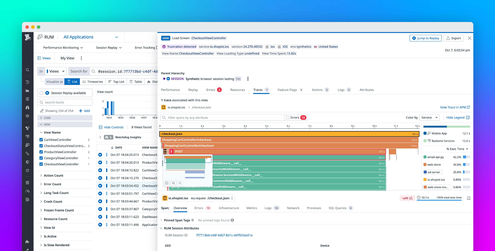

# Ideas: 

## Simulator 
- Synthesize an output based on the columns from the CSV files we have received
- The agent starts its triaging

## Reduce Repeated Work
- Prompt Caching

## Self Improving Agent
- If the agent comes across a new problem, then it writes a new Playbook. 

## Clarifying Questions
- Should we implement RAG/vectors if we wanna scale it up ?
- Should we fine tune our model ?
- What is Level 1 anlysis?
    - How is it different from Level 2?
    Our problem: We dont know when to stop the agent
    - What criterias do we need to 

## Criterias that reduce agent confidence(percentage):
- If it came across the problem for the first time
    - "Based on what I've seen, this is my analysis:"
- If the data source is missing or the data is imperfect
    - Are there any heuristics or criteria we can tell our agent to determine that

## Workflow:
- We load an event from `synthetic_alerts.csv`, give that to LLM ask it to relate an aevent from `historical_incidents.csv`. Then using the fetched event from historical_incident we find the ideal playbook(s) to fetch. Then we follow the steps. The agent generates the report

- We will be using BM25 i.e an Algorithm and semantic matching with 50% weightage on both factors. Semantic is the understanding and BM25 helps with Keyword searches. 

## Human in the Loop
- If AI Agent comes across a new problem or thinks it needs to update the playbooks, then it can generate it, show the difference to the human and ask the human to approve or deny updating/creating a new playbook. 
- The human will see a "Approve" or "Deny" and also have the ability to edit themselves to the AI generated recomemnded changes.

## Report
- Severity
- Confidence Score
- Recommended Next Actions
- What went wrong
- incident logs
- Historical Incidents

Tiered Objectives:
• SIMPLE Analyze incoming security alerts, classify
incident type and severity, and recommend actions
such as monitor, isolate, escalate, or close
- 

• SIMPLE Retrieve the appropriate response playbook
from a knowledge base and use it to guide
investigation steps
- We need an md file that has an index of every playbook imside the ./Playbook folder.

• COMPLEX Capture an explainable, auditable
investigation trail showing evidence reviewed,
procedures consulted, reasoning applied, and
recommended actions Proposed
    - Datadog APM traces is our inspiration design to show the explainable audiatble investigation trail but tailored for our usecase 
    

